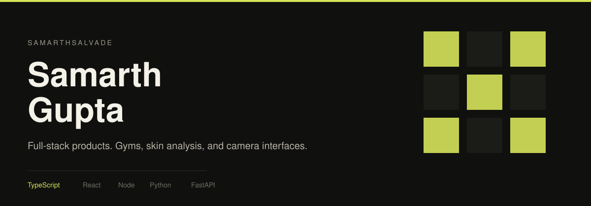
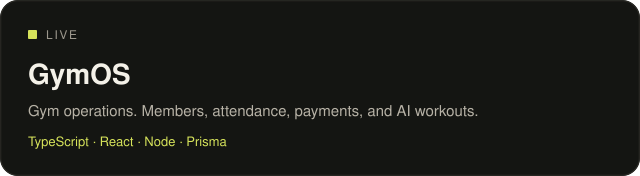
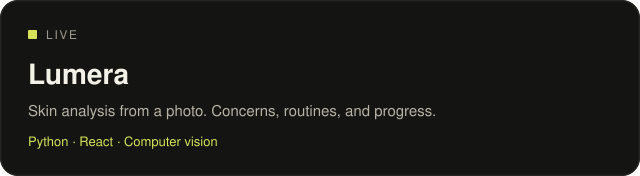
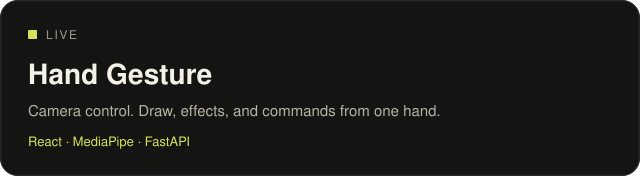
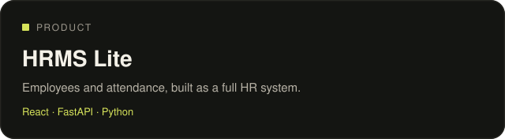
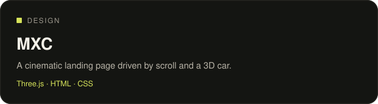
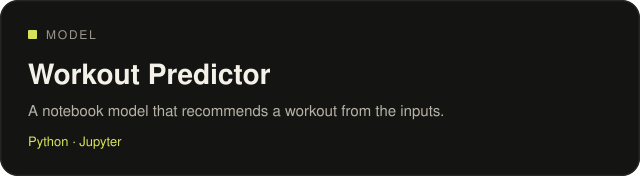

I build software people can open and use. The work below is live: a gym operating system, a skincare product, and interfaces driven by a camera.

## Selected work

<table>
<tr>
<td width="50%">

</td>
<td width="50%">

</td>
</tr>
<tr>
<td width="50%">

</td>
<td width="50%">

</td>
</tr>
<tr>
<td width="50%">

</td>
<td width="50%">

</td>
</tr>
</table>

GymOS is the one to open first. Gym code `DEMO01`, then `admin@fitzone.com` / `admin123`.

<a href="https://github.com/Samarthsalvade/gymos">GymOS source</a> · <a href="https://github.com/Samarthsalvade/Lumera">Lumera source</a> · <a href="https://github.com/Samarthsalvade?tab=repositories">All repositories</a>
